<div align="center">

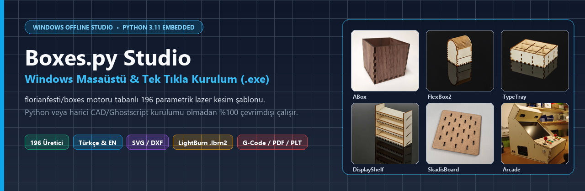

<br />

[](LICENSE)
[](https://github.com/florianfesti/boxes)
[](#kurulum-sihirbazı-ve-hızlı-başlangıç)
[](#mimari-ve-kaynak-koddan-derleme)
[](#196-parametrik-kutu-üretici--kategori-vitrini)
[](#desteklenen-lazer-ve-cnc-çıktı-formatları)

<br />

<h3>
  <a href="Setup_BoxesPy_Studio.exe">Windows Kurulum Dosyasını İndir (Setup_BoxesPy_Studio.exe — 65.2 MB)</a>
</h3>

</div>

---

## Atıf ve Orijinal Proje (Upstream Attribution & Credits)

Bu depo (`boxes_executable`), **[Florian Festi](https://github.com/florianfesti)** ve katkı sağlayan topluluk tarafından geliştirilen açık kaynaklı **[`florianfesti/boxes` (Boxes.py)](https://github.com/florianfesti/boxes)** projesinin Windows masaüstü ve tek tıkla kurulabilir `.exe` dağıtımıdır.

- **Orijinal GitHub Deposu:** https://github.com/florianfesti/boxes
- **Resmi Web Uygulaması:** https://boxes.hackerspace-bamberg.de/
- **Resmi Dokümantasyon:** https://florianfesti.github.io/boxes/
- **Lisans:** [GNU General Public License v3.0 (GPL-3.0)](LICENSE) — Orijinal Boxes.py çekirdek lisansına birebir uygun şekilde yayınlanmaktadır.

### `boxes_executable` Masaüstü Sürümünde Yapılan Geliştirmeler

Resmi **Boxes.py** motorundaki **196 parametrik üreticinin** tamamı ve 480+ görsel örnek fotoğraf korunarak, Windows kullanıcıları için tamamen çevrimdışı ve bağımlılıksız bir stüdyo paketi oluşturulmuştur:

1. **Tek Tıkla Windows Kurulum Sihirbazı (`Setup_BoxesPy_Studio.exe`):** Python kurulumu gerektirmez; gömülü Python 3.11.9 motoru ve tüm kütüphanelerle (`numpy`, `shapely`, `svgpathtools`, `rectpack`, `qrcode`, `pillow`, `affine`, `markdown`, `PyYAML`, `svgwrite`) birlikte gelir. Kurulum sırasında varsayılan dil, malzeme kalınlığı, lazer kerf (yakma) payı ve çıktı formatı `initial_config.json` dosyasına yazılır.
2. **Masaüstü Başlatıcısı & Sistem Tepsisi (`BoxesPy_Studio.exe`):** Yerel döngü adresi (`127.0.0.1:18950+`) üzerinde gizli sunucuyu ayağa kaldırır, Microsoft Edge / Google Chrome'u uygulama penceresi (`--app`) modunda açar ve sistem tepsisinden tek tıkla yönetim sağlar.
3. **Harici Araç Gerektirmeyen Yerel Format Dönüştürücüler:** [`payload/boxes/formats.py`](payload/boxes/formats.py) içinde geliştirilen saf Python dönüştürücüler (`_ps_to_dxf`, `_ps_to_gcode`, `_ps_to_plt`, `_ps_to_pdf`) sayesinde **pstoedit** veya **Ghostscript** kurulumu olmadan `DXF`, `G-Code`, `LightBurn (.lbrn2)`, `PDF`, `PLT`, `SVG` ve `PS` dosyaları doğrudan üretilir.
4. **Türkçe Dil Paketi (`tr`) & Hızlı Çoklu İş Parçacığı Sunucusu:** [`build_locales.py`](build_locales.py) ile oluşturulan Türkçe arayüz çevirisi (`payload/locale/tr/LC_MESSAGES/boxes.py.mo`) ve [`payload/boxes/scripts/boxesserver.py`](payload/boxes/scripts/boxesserver.py) içindeki `ThreadingWSGIServer` mimarisi ile canlı SVG önizleme ve görsel galeri anlık yüklenir.

---

## Kurulum Sihirbazı ve Hızlı Başlangıç

[`Setup_BoxesPy_Studio.exe`](Setup_BoxesPy_Studio.exe) kurulum sihirbazını çalıştırarak 5 adımda kurulumu tamamlayabilirsiniz:

1. **Dil & Karşılama:** Türkçe (TR) ve English (EN) arayüz seçimi.
2. **Kurulum Konumu:** Yönetici izni gerektirmeyen `%LOCALAPPDATA%\BoxesPy_Studio` varsayılan dizini veya özel klasör seçimi.
3. **Lazer & Malzeme Varsayılanları:** Açılışta otomatik uygulanacak malzeme kalınlığı (`thickness`), lazer yakma payı (`burn`), varsayılan çıktı formatı (`format`), iç köşe kesim stili (`inner_corners`), referans ölçeği (`reference`), parça etiketleri (`labels`) ve dış ölçü modu (`outside`).
4. **Kısayollar & Kurulum:** Masaüstü ve Başlat Menüsü kısayolları ile gömülü arşivin çıkarılması.
5. **Tamamlandı:** Kurulum biter bitmez **Boxes.py Studio**'yu başlatma.

<div align="center">
  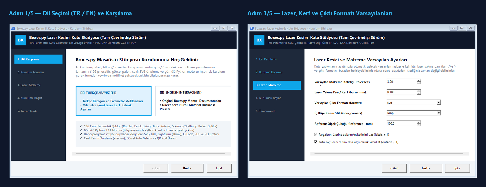
</div>

### Sessiz / Otomatik Kurulum (CLI)

Toplu dağıtım veya betik içi kurulum için komut satırından sessiz kurulum parametresi kullanılabilir:

```powershell
.\Setup_BoxesPy_Studio.exe --silent-install "C:\Araclar\BoxesPy_Studio"
```

Kurulum sonrasında masaüstündeki **Boxes.py Studio** kısayolundan veya doğrudan [`BoxesPy_Studio.exe`](BoxesPy_Studio.exe) dosyasından uygulamayı başlatabilirsiniz.

---

## Uygulama Ekran Görüntüleri

<table>
  <tr>
    <td width="50%" align="center">
      <b>Türkçe Kategorik Menü</b><br /><br />
      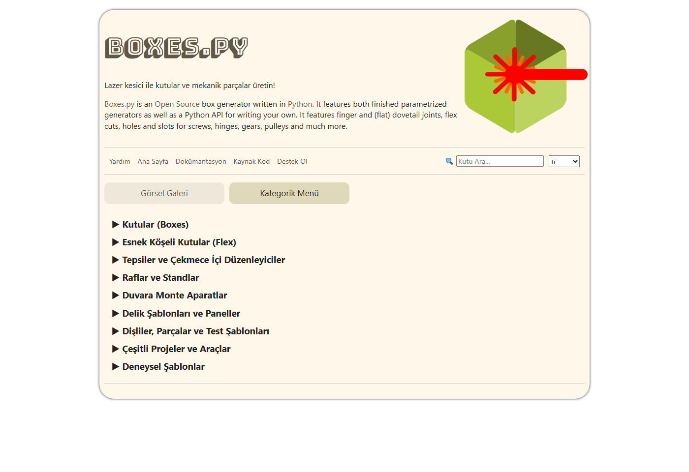
    </td>
    <td width="50%" align="center">
      <b>Görsel Kutu Galerisi</b><br /><br />
      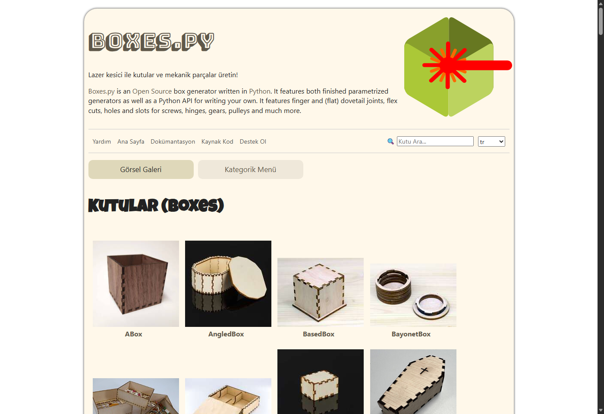
    </td>
  </tr>
  <tr>
    <td colspan="2" align="center">
      <b>Parametrik Kutu Editörü &amp; Canlı SVG Önizleme (ABox — Türkçe Arayüz)</b><br /><br />
      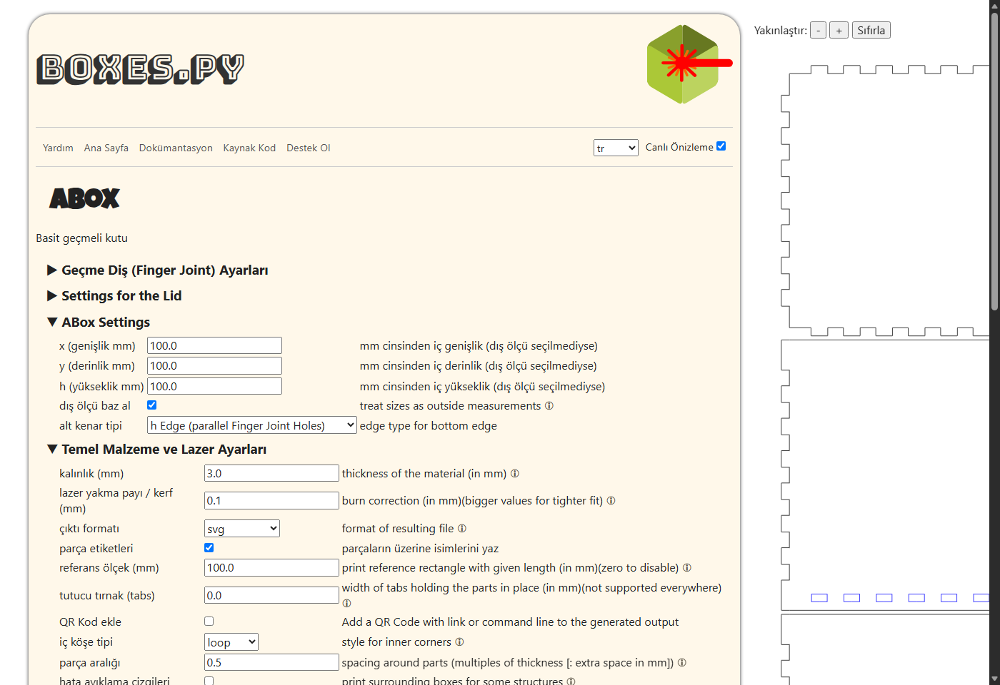
    </td>
  </tr>
</table>

---

## Canlı Lazer Kesim Vektör Çıktısı Örnekleri (SVG)

Uygulama tarafından yerel sunucu üzerinden üretilmiş gerçek parametrik SVG kesim planları (`thickness=3.0 mm`):

<table>
  <tr>
    <th width="50%">ABox — Basit Geçmeli Kutu Kesim Planı</th>
    <th width="50%">TypeTray — Bölmeli Tip Tepsi Kesim Planı</th>
  </tr>
  <tr>
    <td align="center" bgcolor="#ffffff">
      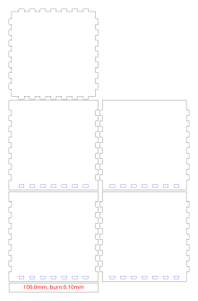
    </td>
    <td align="center" bgcolor="#ffffff">
      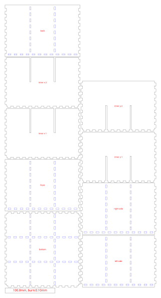
    </td>
  </tr>
</table>

---

## 196 Parametrik Kutu Üretici — Kategori Vitrini

Tüm görseller ve şablon motoru orijinal [`florianfesti/boxes`](https://github.com/florianfesti/boxes) kataloğundan çevrimdışı pakete dahil edilmiştir:

| Kategori | Üretici Sayısı | Örnek Modeller | Görsel Önizleme |
| :--- | :---: | :--- | :---: |
| **Kutular (`Box`)** | 41 | `ABox`, `BayonetBox`, `AngledBox`, `BasedBox`, `UniversalBox`, `ClosedBox` | 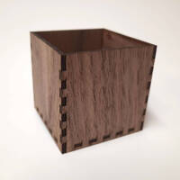 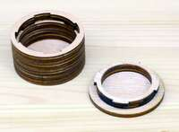 |
| **Esnek Köşeli Kutular (`FlexBox`)** | 14 | `FlexBox2`, `BreadBox`, `DoubleFlexDoorBox`, `FlexBook`, `HeartBox` | 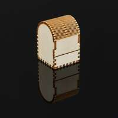 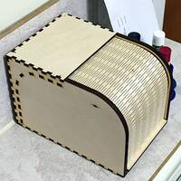 |
| **Tepsiler & Düzenleyiciler (`Tray`)** | 18 | `TypeTray`, `GridfinityBase`, `CompartmentBox`, `DividerTray`, `DrillBox` | 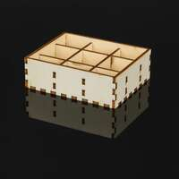 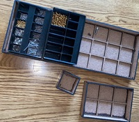 |
| **Raflar & Standlar (`Shelf`)** | 11 | `DisplayShelf`, `CardHolder`, `DiscRack`, `BinTray`, `SBCMicroRack` | 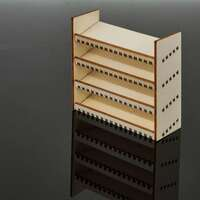 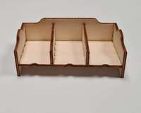 |
| **Duvara Monte Aparatlar (`WallMounted`)** | 22 | `SkadisBoard`, `WallCaliper`, `KeyHolder`, `RollHolder`, `WallToolHolder` | 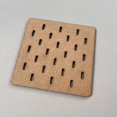 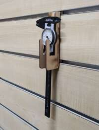 |
| **Delik Şablonları & Paneller (`Holes`)** | 6 | `FanHole`, `NemaPattern`, `FrontPanel`, `HolePattern`, `SevenSegmentPattern` | 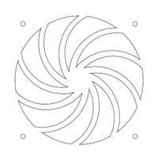 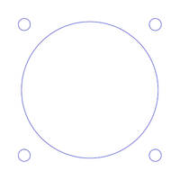 |
| **Dişliler, Parçalar & Test (`Part`)** | 18 | `Gears`, `GearBox`, `BurnTest`, `ConcaveKnob`, `FlexTest`, `Pulley` | 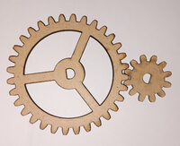 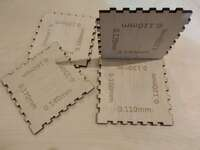 |
| **Çeşitli Projeler & Deneysel (`Misc` / `Unstable` / `Beekeeping`)** | 66 | `Arcade`, `Castle`, `AirPurifier`, `AgricolaInsert`, `BeeQueenTransportBox` | 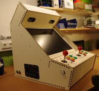 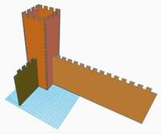 |

---

## Desteklenen Lazer ve CNC Çıktı Formatları

Harici `pstoedit` veya `ps2pdf` ikili dosyaları kurulmamış sistemlerde dahi [`payload/boxes/formats.py`](payload/boxes/formats.py) içerisindeki yerel Python vektör motoru devreye girerek tüm CAD/CAM formatlarını hatasız üretir:

| Format | Uzantı | Kullanım Alanı | Üretim Yöntemi (`formats.py`) |
| :--- | :--- | :--- | :--- |
| **`svg`** | `.svg` | Genel vektör düzenleme (Inkscape, Illustrator, Web önizleme) | Doğrudan `SVGSurface` motoru |
| **`svg_Ponoko`** | `.svg` | Ponoko ve katman rengine duyarlı lazer kesim servisleri | Doğrudan `SVGSurface` (Ponoko profili) |
| **`lbrn2`** | `.lbrn2` | Doğrudan LightBurn proje ve kesim katmanı aktarımı | Doğrudan `LBRN2Surface` motoru |
| **`dxf`** | `.dxf` | AutoCAD, CorelDRAW, RDWorks, Fusion 360 (mm ölçekli, ACI renk katmanlı) | Yerel saf Python `_ps_to_dxf` (veya sistemdeki `pstoedit`) |
| **`gcode`** | `.gcode` | GRBL tabanlı DIY diyot/CO2 lazer ve CNC kontrolcüleri (`G21`, `G90`, `M3`/`M5`) | Yerel saf Python `_ps_to_gcode` |
| **`pdf`** | `.pdf` | Vektörel baskı şablonu ve belge paylaşımı (PDF 1.4 vektör yolları) | Yerel saf Python `_ps_to_pdf` (veya sistemdeki `ps2pdf`) |
| **`plt`** | `.plt` | HPGL (40 birim/mm) destekli kesici plotter ve endüstriyel makineler | Yerel saf Python `_ps_to_plt` |
| **`ps`** | `.ps` | Ham PostScript vektör çıkışı | Doğrudan `PSSurface` motoru |

---

## Mimari ve Kaynak Koddan Derleme

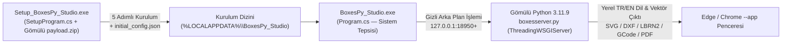

### Depo Yapısı

- [`SetupProgram.cs`](SetupProgram.cs) — 5 adımlı grafiksel Windows kurulum sihirbazı ve `--silent-install` motoru
- [`Program.cs`](Program.cs) — Tek örnek korumalı (`Mutex`), sistem tepsili masaüstü başlatıcısı
- [`build_locales.py`](build_locales.py) — Türkçe `.po` oluşturucu ve `.mo` derleyici
- [`payload/boxes/formats.py`](payload/boxes/formats.py) — Saf Python `DXF`, `G-Code`, `PLT` ve `PDF` dönüştürücü eklentisi
- [`payload/boxes/scripts/boxesserver.py`](payload/boxes/scripts/boxesserver.py) — `ThreadingWSGIServer` ve `initial_config.json` okuyuculu yerel HTTP sunucusu
- [`build_exe.ps1`](build_exe.ps1), [`create_payload.ps1`](create_payload.ps1), [`build_setup.ps1`](build_setup.ps1) — `.NET Framework csc.exe` derleme ve paketleme betikleri

### Kaynak Koddan Yeniden Derleme (Windows PowerShell)

Gömülü Python 3.11.9 klasörü (`payload/python/`) kuruluysa doğrudan aşağıdaki adımlarla hem başlatıcıyı hem tek dosya kurulum paketini sıfırdan derleyebilirsiniz:

```powershell
# 1. Dil dosyalarını (.mo) derle
.\payload\python\python.exe .\build_locales.py

# 2. BoxesPy_Studio.exe başlatıcısını derle
.\build_exe.ps1

# 3. payload klasörünü payload.zip olarak sıkıştır
.\create_payload.ps1

# 4. payload.zip'i gömerek Setup_BoxesPy_Studio.exe kurulumunu oluştur
.\build_setup.ps1
```

---

<div align="center">
  <b>Orijinal Motor:</b> <a href="https://github.com/florianfesti/boxes">florianfesti/boxes</a> &nbsp;|&nbsp;
  <b>Lisans:</b> <a href="LICENSE">GNU GPL v3.0</a>
</div>
